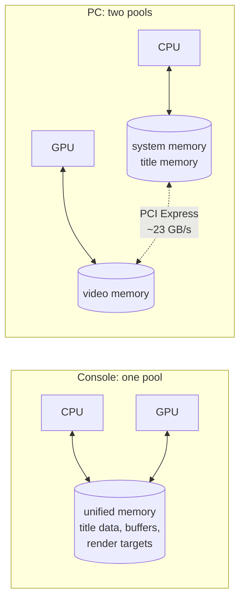
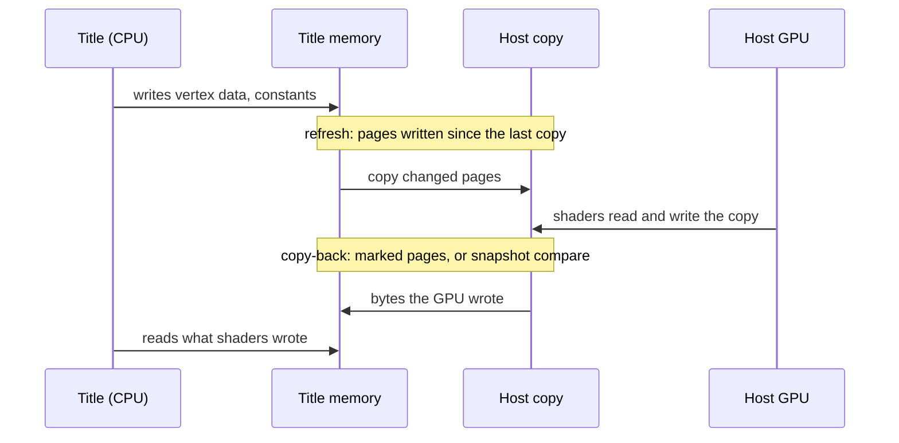
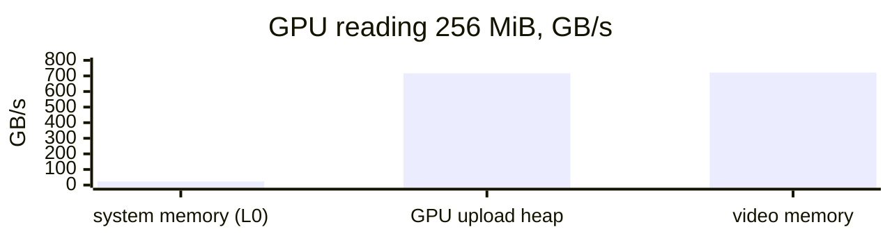
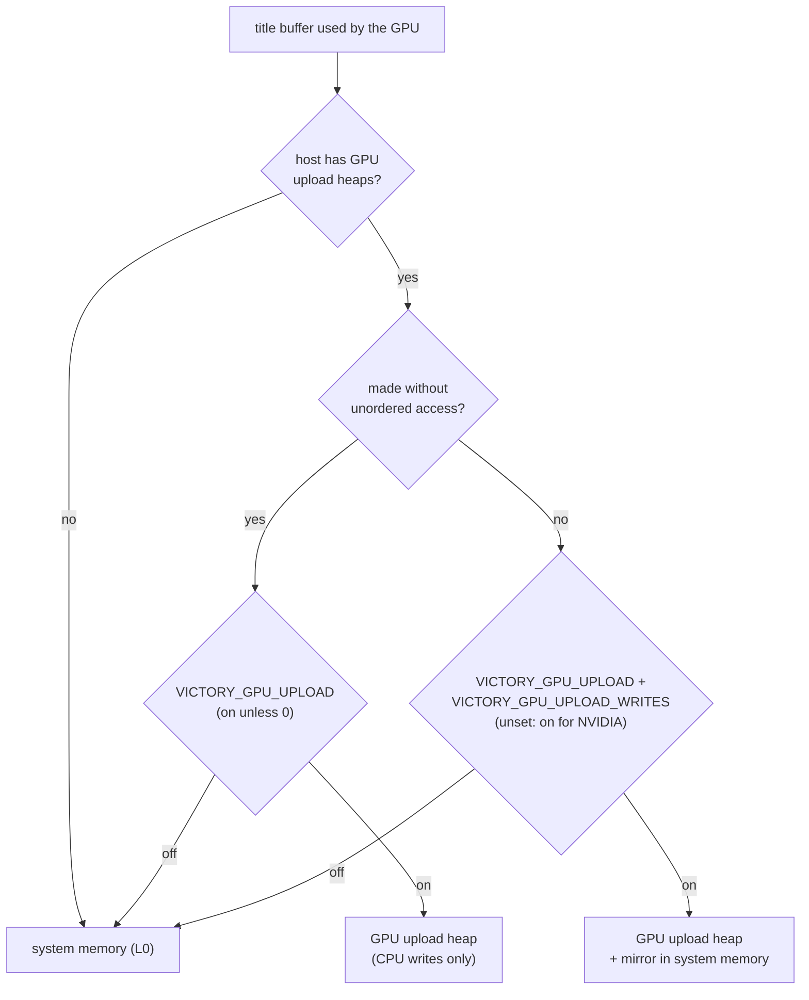
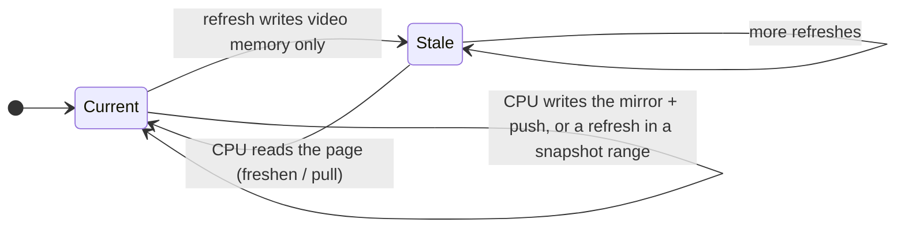
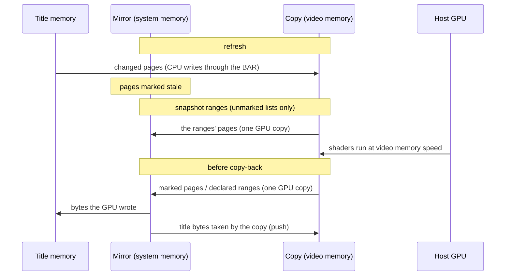
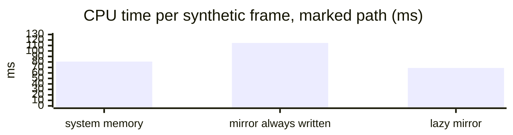

# GPU memory: bridging unified and split memory

An Xbox Series console has one pool of memory. The CPU and the GPU read
and write the same bytes at the same addresses, and a title is written
for that: it builds vertex data, constants and command buffers in place,
hands the GPU their addresses, and reads back what shaders wrote, all
without copying anything.

A desktop PC (Apple silicon and integrated GPUs aside) has two pools:
system memory next to the CPU and video memory on the graphics card,
joined by PCI Express. Each processor is fast in its own pool and slow in
the other one. This page covers how `victory-gpu` bridges the two, what
each choice costs, and the switches that choose where the data lives.

## Host copies of title memory

Title memory sits in system memory, at the addresses the title chose.
The host GPU cannot use those addresses, so every title buffer a draw or
dispatch uses gets a **host copy** (`crate::shadow::Shadow`): a D3D12
buffer of the same size. A title GPU address inside the buffer maps to
the same offset in its copy. Around each submission:

1. **Refresh.** Before the submission runs, the ranges it reads (vertex,
   index and constant data, buffer views, or everything a heap-indexing
   shader can reach) are brought up to date from title memory. Only the
   64 KiB pages the title wrote since the last copy are copied
   (`crate::watch` tracks them with write-watch and read-only guards).
2. **Run.** The host GPU reads and writes the copies.
3. **Copy-back.** What shaders wrote goes back into title memory, without
   overwriting what the title wrote in the meantime. There are two ways
   to find out what shaders wrote:
   - **Marked pages.** Translated shaders set a bit for each page they
     write through a buffer view (`victory_shader::emit`, "Write marks").
     Only those pages are compared with title memory.
   - **Snapshots.** For a range a list declares as written without marks,
     the copy's bytes are saved before the submission and compared after
     it. Whatever changed is what the GPU wrote.

## Where the copies live

A copy can be in **system memory**, mapped write-back for the CPU
(`Host::shared_buffer`: a custom heap, `MEMORY_POOL_L0`). The CPU writes
and reads it at full speed, but every shader access crosses PCI Express.
That is where copies go on a host without GPU upload heaps (below), and
where every copy was before 2026-11-25.

On a GPU with **Resizable BAR**, D3D12 also offers **GPU upload heaps**
(`D3D12_HEAP_TYPE_GPU_UPLOAD`, reported by
`D3D12_OPTIONS16.GPUUploadHeapSupported`). These are video memory that
the CPU can map and write through the BAR. Shaders access them at
video-memory speed. CPU writes stream across the bus at about the speed
of a system-memory write. CPU reads are uncached and very slow.

Measured on an RTX 5070 Ti (driver 621.24), Ryzen 9 7900X, Windows 11,
256 MiB at a time:

| | GPU reads | CPU writes | CPU reads |
|---|---|---|---|
| system memory (`L0`, the default for copies) | 22.9 GB/s | 28.7 GB/s | 22.7 GB/s |
| GPU upload heap (video memory through the BAR) | 716.8 GB/s | 22.7 GB/s | **0.05 GB/s** |
| video memory, default heap | 721.2 GB/s | (no CPU access) | (no CPU access) |

So a copy shaders use heavily belongs in video memory, but the CPU must
never read it there. Where the host has GPU upload heaps, every copy of a
title buffer shaders only read goes there **by default**
(`host::upload_placement`, decided once per run), and on NVIDIA so does
every copy shaders write, with a mirror. Two switches change it:

| switch | default where the host has GPU upload heaps | copies in a GPU upload heap | what the CPU reads |
|---|---|---|---|
| `VICTORY_GPU_UPLOAD` | on; `0` keeps every copy in system memory | buffers made without unordered access (shaders only read them) | nothing: the CPU only writes these copies |
| `VICTORY_GPU_UPLOAD_WRITES` | on NVIDIA (with the one above); `0` keeps these in system memory, `1` puts them in video memory on any GPU | buffers shaders may write | a **mirror** in system memory |

Any value but `0` (`1`, say) leaves a switch on. On a host without GPU
upload heaps (no Resizable BAR, older runtimes or drivers) every copy is
in system memory whatever the switches say; the log line
`host copies of title buffers in GPU upload heaps` gives the outcome.
Copies also fall back to system memory past their share of the video
memory budget
(`UPLOAD_POOL`, see [below](#video-memory-budget-and-residency); a copy's
bytes are given back when D3D12 destroys its buffer). Copies
of loose title memory and of single views (`loose`, `exact`) always stay
in system memory.

## Written copies: video memory with a lazy mirror

A copy that shaders write has to be read by the CPU: copy-back compares
it with title memory, and snapshots are taken from it. Reading it from
the upload heap at 50 MB/s is out of the question, so such a copy has two
parts:

- **the copy in video memory**, which shaders use and which always holds
  the current bytes;
- **the mirror** in system memory, which the CPU reads. It may be behind
  the copy in video memory, one 64 KiB page at a time.

The rules that keep them consistent:

- **Refreshes write video memory only** (`Shadow::copy`) and mark the
  pages they touched as stale in the mirror (a bit per page,
  `Vram::stale`). Writing the mirror as well would double the CPU's
  refresh cost, and on the marked path nothing ever reads those bytes.
- **Any other CPU write to the mirror goes on into video memory**
  (`Shadow::push`): copy-back taking the title's bytes, and the update of
  a snapshot under a busy range.
- **Before the CPU reads the mirror, its stale pages come back from video
  memory.** The GPU copies them (`Shadow::freshen` → `bring_back` →
  `Host::copy_now`: one command list, one fence wait, for any number of
  pages). The same goes for pages shaders wrote (`shadow::pull`): the
  marked pages before their copy-back, and the declared ranges with
  snapshots.
- **A submission's snapshots are prepared up front.** Before a
  submission, `Host::execute` collects the ranges its lists declare as
  written without marks (`shadow::snapshots_ahead`). Their pages come
  back whole in one GPU copy, and until the copy-backs, refreshes in those
  pages write the mirror as well. A snapshot then never waits for the
  GPU. Whole pages, not only stale ones: an earlier shader may have
  written there through a view no list declared, which leaves video
  memory ahead with no stale bit. A snapshot without that byte would take
  it for this submission's write and put it over the title's.
- **Page bits are cleared under the page lock, around the GPU copy.** A
  refresh that races the copy sets its bit again once the lock is
  released, so its bytes are not lost.
- **If the GPU copy fails, the CPU reads video memory instead.**
  `Host::copy_now` reports whether it saw its fence reached on a live
  device. When it did not (no copier, a failed call, a removed device),
  `bring_back` reads the pages through the CPU's mapping of video memory.
  That is slow (~50 MB/s), but the mirror still gets what shaders wrote,
  and the copy-back neither loses it nor writes the mirror's old bytes
  into title memory. Written copies made after that stay in system
  memory.

### What it costs and what it buys

On the GPU side, from the tests `reading_copies_in_video_and_system_memory`
and `written_copies_in_video_and_system_memory` (release, same machine):

| 256 MiB, one copy | system memory | video memory | |
|---|---|---|---|
| shader reads (read-only buffer) | 11.64 ms (23.1 GB/s) | 0.37 ms (722 GB/s) | 31× |
| shader reads and writes (written buffer) | 212.23 ms | 1.25 ms | 170× |

Bringing pages back costs a fixed 0.05 ms (a list and a fence wait),
plus the copy itself: 64 scattered pages (4 MiB) take 0.23 ms.

On the CPU side, a synthetic world frame (#1743's shape: a 174 MB heap,
36 submissions with 24 declared ranges each; median of three interleaved
runs, ms per frame):

| path | copies in system memory | written copies in video memory, mirror always written | lazy mirror (now) |
|---|---|---|---|
| marked pages | 80.7 | 114.6 | **69.0** |
| snapshots of declared ranges | 708 | 910 | 950 |

On the marked path the lazy mirror costs less CPU time than copies in
system memory. A refresh writes each changed page once, through the BAR,
where it used to write system memory, and only the pages shaders marked
come back. The snapshot path pays for bringing every declared range back
before its compare (several GB per frame here): it needs marks to
benefit.

### A compute-heavy submission: why both are on by default

The tables above time one big copy. The test
`shadow::bench::compute_heavy_submissions_by_copy_placement` times what a
title's compute passes look like instead, through the copies' real paths
(`shadow::find`, `Shadow::refresh`, `Shadow::gpu_writes`, `HostList`,
`Host::execute`): one submission of 200 dispatches in 8 lists over six
title buffers (four of 64 MiB made without unordered access, two of
32 MiB shaders write; 320 MiB in all). Each dispatch reads 4 MiB of a
read-only buffer, reads and writes 1 MiB of a written one (24 MiB of each
are written over the submission) and reads 256 KiB of the title's data
in the rest of it, with a UAV barrier after each. Shaders find what they
wrote by write marks (each store sets its page's bit where still clear,
as translated shaders do) or by snapshots of the declared ranges. Between
submissions the title leaves its data alone, or writes 16 MiB of it
(12 MiB in the read-only buffers, 2 MiB in each written one's title
part), which the next refresh copies. Each placement runs in a child
process of its own, and the test checks that all of them leave title
memory the same. Median of three runs of the median of 5 submissions,
ms (`total`: all of `Host::execute`; `prepare`: refreshes and snapshots;
`GPU`: the wait for the GPU; `copy-back`: comparing and copying what
shaders wrote, including bringing it back from video memory):

| copies | writes found by | title writes | total | prepare | GPU | copy-back |
|---|---|---|---|---|---|---|
| system memory | write marks | none | 59.7 | 0.0 | 44.0 | 15.7 |
| system memory | write marks | 16 MiB per submission | 61.6 | 2.3 | 43.8 | 15.2 |
| system memory | snapshots | none | 73.5 | 12.4 | 43.4 | 17.8 |
| system memory | snapshots | 16 MiB per submission | 76.4 | 14.6 | 43.0 | 18.1 |
| read-only copies in video memory | write marks | none | 31.0 | 0.0 | 15.7 | 15.1 |
| read-only copies in video memory | write marks | 16 MiB per submission | 32.9 | 2.1 | 15.8 | 15.0 |
| read-only copies in video memory | snapshots | none | 43.3 | 12.2 | 12.9 | 18.3 |
| read-only copies in video memory | snapshots | 16 MiB per submission | 45.6 | 14.3 | 12.8 | 18.2 |
| all copies in video memory | write marks | none | 31.7 | 0.0 | 12.0 | 19.6 |
| all copies in video memory | write marks | 16 MiB per submission | 32.3 | 1.8 | 11.0 | 19.4 |
| all copies in video memory | snapshots | none | 35.9 | 12.1 | 2.1 | 21.8 |
| all copies in video memory | snapshots | 16 MiB per submission | 37.7 | 14.0 | 2.1 | 21.4 |

`cargo test --release -p victory-gpu --lib compute_heavy -- --ignored --nocapture`
(RTX 5070 Ti, driver 621.24, Ryzen 9 7900X, Windows 11).

- **Read-only copies in video memory** halve the submission with write
  marks (60 ms to 31) and save 40% with snapshots (74 to 43): the GPU's
  time drops from 44 ms to 16 (13 with snapshots), and nothing else
  changes. Refreshing them through the BAR costs what refreshing system
  memory does (2 ms for 16 MiB either way).
- **Written copies in video memory as well** take the GPU's time down to
  11-12 ms with marks and 2 ms with snapshots. Bringing what shaders
  wrote back to the mirrors (48 MiB per submission here) adds 4 ms to the
  copy-back. CPU and GPU together, that is even with marks (31.7 and
  32.3 ms against 31.0 and 32.9, within the runs' spread) and 17% faster
  with snapshots (36 ms against 43). The GPU's own time is a quarter
  lower with marks, and a sixth of what it was with snapshots: time a
  title's draws can use.
- With all copies in video memory the marked path spends about 9 of its
  11-12 GPU milliseconds marking: the written-pages bitmap is in system
  memory and each store reads it across the bus (see
  [further steps](#further-steps)). Without that cost, written copies in
  video memory would gain with marks as they do with snapshots.

So on NVIDIA both switches are on by default where the host has GPU
upload heaps: written copies in video memory were never slower beyond the
runs' spread, faster with snapshots, and took less of the GPU. On an AMD
RX 9070 XT they saved less GPU time in a world frame than their mirrors
added to preparing and copying back, so elsewhere written copies stay in
system memory unless `VICTORY_GPU_UPLOAD_WRITES=1`. The synthetic world frame above shows the case where written copies in
video memory cost more CPU time than they save: a frame whose shaders
write gigabytes of declared ranges without marks. Translated shaders
mark their writes through views, so such ranges are rare; where a title
still has them, `VICTORY_GPU_UPLOAD_WRITES=0` keeps written copies in
system memory.

### Title memory outside buffers

Titles also hand the GPU memory that belongs to no buffer object (Grand
Theft Auto VI's interface vertices, from its own allocator). Such memory
gets copies of the 4 MiB windows it touches (`shadow::loose`). Shaders may
write any of it, so a window's copy is placed as a written buffer's is: in
video memory with a mirror where the host puts those there (NVIDIA with
GPU upload heaps by default, `VICTORY_GPU_UPLOAD_WRITES=1` elsewhere), else
in system memory.

The same compute-heavy submission with every byte of its title memory
outside any buffer (`VICTORY_TEST_BENCH_LOOSE=1`), RTX 5070 Ti, median of
three runs, ms:

| windows' copies | writes found by | title writes | total | prepare | GPU | copy-back |
|---|---|---|---|---|---|---|
| system memory | write marks | none | 66.3 | 0.0 | 48.3 | 17.9 |
| system memory | write marks | 16 MiB per submission | 72.9 | 3.1 | 49.8 | 19.4 |
| system memory | snapshots | none | 95.4 | 18.2 | 50.7 | 26.5 |
| system memory | snapshots | 16 MiB per submission | 103.1 | 22.3 | 51.7 | 27.8 |
| video memory, with mirrors | write marks | none | 30.6 | 0.0 | 9.8 | 21.4 |
| video memory, with mirrors | write marks | 16 MiB per submission | 32.5 | 1.9 | 10.0 | 20.9 |
| video memory, with mirrors | snapshots | none | 39.8 | 14.0 | 2.1 | 23.2 |
| video memory, with mirrors | snapshots | 16 MiB per submission | 44.4 | 16.9 | 2.1 | 25.2 |

A submission takes 54-57% less: the GPU's time drops from about 50 ms to
10 (2 with snapshots), and copy-back stays within a few ms. Making the
windows' copies the first time costs more (133-159 ms against 20-34 for
system memory). Copies of single views off their buffer's elements
(`shadow::exact`, ~2 KB each, in shared buffers) stay in system memory.

## Unified hosts: title memory in place

On a host whose GPU shares memory with the CPU (an AMD or Intel APU, an
integrated GPU, Apple silicon under a translation layer), there is one
pool, as on the console. Every placement reads at the same speed there,
so a host copy buys no GPU time and only costs its refreshes, snapshots
and copy-backs. `crate::unified::detect` asks the device at host creation
(`D3D12_FEATURE_DATA_ARCHITECTURE1.UMA`, `GPUUploadHeapSupported`, the
memory budgets; about 0.3 ms) and logs the answer (`host GPU memory: ...`).

Where the host reports unified memory, `crate::in_place` gives each title
buffer of 64 KiB or more no copy at all: its host buffer is title memory
itself, a heap opened over the buffer's own pages
(`ID3D12Device13::OpenExistingHeapFromAddress1`) with one buffer placed at
its start. The GPU reads what the title wrote, and the title reads what
the GPU wrote, in the same pages: no refresh, no snapshot, no copy-back,
and no second copy of the memory.

Before turning that on, the host checks once that title memory really is
shared (`crate::unified::self_test`): it opens a block of memory
allocated as the title's pools are, has the GPU copy bytes out of it and
into it, and checks that each processor saw the other's writes. A
translation layer can have the method and still give the GPU new memory
(vkd3d-proton without `VK_EXT_external_memory_host`). If the test fails,
the copies stay and the log says why.

| `VICTORY_IN_PLACE` | title buffers |
|---|---|
| unset | in place where the host reports unified memory and the self-test passes |
| `1` | in place wherever the host can open title memory as a heap |
| `0` | copied |

What holding title memory as a heap implies, and how it is handled:

- **The title cannot free, protect or remap memory a heap holds**
  (Windows refuses with error 87). Every heap is registered with
  `crate::pinned`, and the title's `VirtualFree`, `VirtualProtect` and
  `UnmapViewOfFile*` (`victory-hle`'s `memoryapi`, and the runtime's own
  unmapping in `xmem`) go through `title_memory_change`: buffers in place
  over the range are dropped first, and the change is retried for up to
  100 ms while the lists still holding them are reset.
- **The heap lives as long as anything placed in it.** Each buffer holds
  its heap through private data, and the heap's registration goes when the
  heap is destroyed (`ID3DDestructionNotifier`). vkd3d-proton destroyed a
  heap once its own references went, though its buffer still lived.
- **Write watching does not see the GPU's writes.** Other copies of the
  same pages (a view's own copy, textures' uploads) cannot guard pages a
  heap holds either, so their pages stay changed and are copied at each
  use: they see what the GPU wrote.
- **Withholding** (`crate::memory::withholding`): what a program using
  title memory at computed addresses writes stays out of title memory
  when such a program missed memory. A buffer in place cannot hold
  anything back, so a buffer such a program writes gets a copy from its
  next use on. The submission that wrote it in place keeps the declared
  range's bytes beforehand and puts them back if its writes are withheld.
  Such programs also reach title memory through a page table naming every
  host buffer (`crate::memory`): once one is made, buffers shaders may
  write are copied instead, and only buffers made without unordered access
  stay in place.

### What it saves

The compute-heavy submission above, on the Ryzen 9 7900X's integrated
Radeon (`VICTORY_TEST_ADAPTER=radeon`), with each placement in its own
process and title memory checked to end up the same in all of them.
Median of three runs of the median of 5 submissions, ms. `making buffers`
is the one-time cost of the first use of the six buffers (allocating the
copies, or opening the heaps), and `first submission` the submission after
it (copying everything in):

| copies | writes found by | title writes | total | prepare | GPU | copy-back | making buffers | first submission |
|---|---|---|---|---|---|---|---|---|
| system memory | write marks | none | 58.9 | 0.0 | 44.0 | 14.9 | 30.0 | 111.4 |
| system memory | write marks | 16 MiB per submission | 59.8 | 2.3 | 42.5 | 14.9 | 25.7 | 111.2 |
| system memory | snapshots | none | 70.1 | 11.7 | 40.3 | 17.5 | 28.1 | 134.4 |
| system memory | snapshots | 16 MiB per submission | 71.1 | 14.3 | 39.7 | 17.1 | 26.4 | 122.1 |
| read-only copies in video memory | write marks | none | 58.7 | 0.0 | 43.9 | 14.8 | 31.3 | 104.1 |
| read-only copies in video memory | write marks | 16 MiB per submission | 60.2 | 2.1 | 42.5 | 15.2 | 25.7 | 102.4 |
| read-only copies in video memory | snapshots | none | 68.6 | 11.7 | 39.6 | 17.2 | 25.9 | 127.6 |
| read-only copies in video memory | snapshots | 16 MiB per submission | 70.8 | 13.7 | 39.5 | 17.0 | 25.1 | 113.7 |
| all copies in video memory | write marks | none | 65.5 | 0.0 | 44.4 | 20.7 | 41.0 | 108.0 |
| all copies in video memory | write marks | 16 MiB per submission | 65.6 | 2.1 | 42.7 | 20.7 | 31.8 | 109.6 |
| all copies in video memory | snapshots | none | 75.3 | 12.0 | 40.1 | 23.4 | 30.6 | 137.4 |
| all copies in video memory | snapshots | 16 MiB per submission | 76.9 | 13.9 | 39.8 | 23.2 | 30.2 | 124.9 |
| no copies: title memory in place | write marks | none | 40.6 | 0.0 | 40.3 | 0.1 | 127.6 | 40.4 |
| no copies: title memory in place | write marks | 16 MiB per submission | 41.1 | 0.0 | 40.9 | 0.2 | 126.3 | 40.1 |
| no copies: title memory in place | snapshots | none | 40.5 | 0.0 | 40.1 | 0.2 | 127.7 | 39.9 |
| no copies: title memory in place | snapshots | 16 MiB per submission | 40.9 | 0.0 | 40.6 | 0.2 | 127.1 | 40.2 |

- **In place**, a submission takes 40.5-41.1 ms in every mode, against
  58.9-71.1 ms with copies in system memory (the default before): 31%
  less with write marks, 42% less with snapshots. The refreshes (up to
  14 ms), snapshots and copy-backs (15-17 ms) are gone; the GPU's own time
  stays the same (40-41 ms against 40-44).
- The one-time cost moves: opening heaps over 320 MiB of title memory
  takes about 127 ms, against 25-30 ms for allocating copies, and
  the first submission no longer copies everything in (40 ms against
  111-134): the first use costs about the same either way (167 ms against
  137-162), and every submission after it is 18-30 ms shorter.
- **Memory:** the 320 MiB of copies are not made.
- **Video memory placements** buy nothing here: the "video memory" is the
  same memory.

On a discrete GPU, in place reads title memory across the bus, as copies
in system memory do: on the RTX 5070 Ti it is faster than copies in
system memory (no refreshes or copy-backs) but slower than copies in
video memory, so it stays off there unless `VICTORY_IN_PLACE=1`
(RTX 5070 Ti, the same runs; system memory and video memory rows in the
table above):

| copies | writes found by | title writes | total | prepare | GPU | copy-back | making buffers | first submission |
|---|---|---|---|---|---|---|---|---|
| no copies: title memory in place | write marks | none | 43.6 | 0.0 | 43.4 | 0.1 | 55.2 | 45.2 |
| no copies: title memory in place | write marks | 16 MiB per submission | 43.7 | 0.0 | 43.6 | 0.1 | 57.9 | 45.4 |
| no copies: title memory in place | snapshots | none | 43.8 | 0.0 | 43.6 | 0.1 | 56.9 | 43.9 |
| no copies: title memory in place | snapshots | 16 MiB per submission | 43.8 | 0.0 | 43.6 | 0.2 | 57.5 | 43.9 |

## Video memory budget and residency

Windows gives each process a **video memory budget**
(`IDXGIAdapter3::QueryVideoMemoryInfo`), for video memory (the local
segment group) and for the system memory the GPU reads across the bus
(non-local). It changes while running, as other processes take and free
memory. When a process uses more than its budget, the video memory
manager **demotes** some of its allocations to system memory. Shaders
then reach them across PCI Express, which is 30 times slower or worse
(see the tables above). If a render target or depth buffer is demoted,
every frame waits on the bus, and frames take seconds.

VIctory does three things about it. Host textures fed from title memory
are given up past nine tenths of the budget, the least recently used
first, down to 85 % (`resource::evict_unused`), and made again from
title memory on their next use. The other two follow.

**Residency priorities.** The manager demotes allocations with the
lowest residency priority first (`ID3D12Device1::SetResidencyPriority`).
`crate::host::keep_resident` sets it where VIctory makes an allocation:

| allocation | priority | why |
|---|---|---|
| host textures with the render target, depth stencil or unordered access flag | `HIGH` | the GPU writes them every frame, and they hold the only copy of what it wrote |
| view heaps' stride, mark and address tables | `HIGH` | every draw reads them |
| the views' written-pages bitmap | `HIGH` | shaders that mark their writes set it every frame |
| list scratch chunks | `HIGH` | the list's commands read them |
| host copies in GPU upload heaps | `HIGH` | shaders read them every frame; they are budgeted (below) |
| host textures uploaded from title memory (`texture::title_written`) | `NORMAL` | streamed: each is read by some frames only, and sampling one from system memory is slower without stalling the frame |

Descriptor heaps get none: on an RTX 5070 Ti (driver 621.24) a priority
on a shader-visible descriptor heap removed the device at the next
submission.

`NORMAL` is what every allocation starts with, so streamed textures and
everything VIctory does not name go first. `MAXIMUM` is not used: the
system keeps such allocations even past the budget, at the cost of other
processes. `LOW` is not used either: it would demote streamed textures
before allocations that have no priority set (depth twins, upload
staging), which frames need no more than these.

**Pools sized from the budget.** `crate::budget` reads DXGI at most every
250 ms, and again as soon as the system signals a budget change
(`RegisterVideoMemoryBudgetChangeNotificationEvent`), so pools can ask it
as often as they like. Bytes a pool takes between readings
(`Budget::charge`) count as used until the next reading includes them.
A pool asks `Budget::limit` how much it may hold now: a part of what the
rest of the process leaves of the local budget, up to a ceiling. Its own
bytes do not shrink the answer, everyone else's do.

The copies in GPU upload heaps (`UPLOAD_POOL`) take half of what the rest
of the process leaves. The ceiling is 2 GiB (the fixed size of before), or
a quarter of the budget where that is more. On a host that reports no
budget, the ceiling applies. A copy that does not fit stays in system
memory, as before. Examples:

| local budget | used by the rest of the process | copies may hold |
|---|---|---|
| 7.5 GB (8 GB card) | 2 GB | 2 GiB (ceiling) |
| 7.5 GB | 5 GB | 1.25 GB |
| 7.5 GB | 7.5 GB or more | nothing |
| 15 GB (16 GB card) | 4 GB | 3.75 GB (a quarter of the budget) |

The first time use passes nine tenths of the local budget, a warning
names what VIctory knows takes it: host textures (all of them, and those
lists used), host copies of title memory (all of them, and those in GPU
upload heaps), and the non-local segment's use and budget. The check runs
with each frame-rate line, whether or not a pool asks.

## Measuring a title

The tests show the mechanism. Whether it pays off in a title depends on
how much of the title's GPU time goes to shaders reading these copies,
and that needs a run of the title. Compare `VICTORY_GPU_TIMING=1` as it
is and with `VICTORY_GPU_UPLOAD=0` (or `VICTORY_GPU_UPLOAD_WRITES=0`),
together with the copy counters (`--features diagnostics`).

## Further steps

- Move copies between pools while running, according to how they are
  used (read-mostly, written by shaders, or read back by the CPU).
- Give snapshot ranges marks, or compare them on the GPU, so they no
  longer need their bytes brought back.
- Keep the written-pages bitmap where shaders set it fast (video memory,
  copied back for the CPU after each submission), or mark less often
  than once per store: in the compute-heavy submission above, marking
  takes most of the GPU's time once the copies are in video memory.
- Detile textures on the GPU, so their upload crosses the bus once,
  still tiled.
